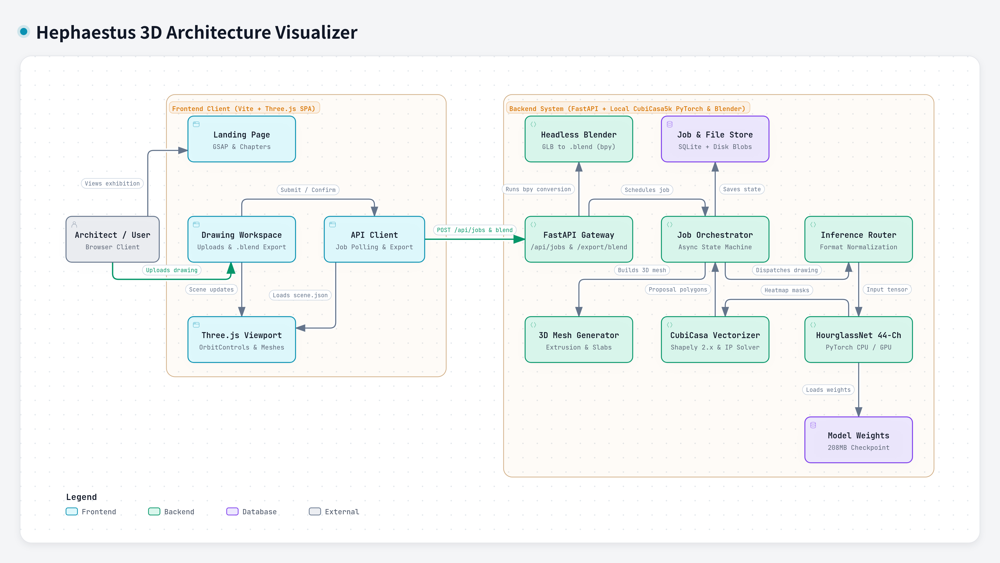

# Hephaestus

> _From drawing. To space._  
> _"Imagination is beginning, hephaestus brings it closer."_

Hephaestus is an interactive 3D architecture visualizer designed to bridge the gap between 2D floor plans (PNG, SVG, DXF) and spatial 3D building models.

---

## Target Audience

Hephaestus is built as an educational and exploratory visual aid for:

- **Architecture & Design Students**: Learn to read 2D drawings and immediately visualize how lines, boundaries, and openings translate into 3D spatial forms.
- **Civil Engineering & Construction Learners**: Develop spatial intuition, inspect structural envelopes, and examine floor plan geometry interactively.
- **Educators & Mentors**: Present architectural plans with real-time 3D models and synchronized 2D/3D component inspection.

---

## Features

- **Interactive 3D Viewer**: Real-time orbit, pan, zoom, section clipping, and component inspection powered by Three.js.
- **Drawing-to-Model Workspace**: Inspect source 2D drawings alongside reconstructed 3D geometry with synchronized selection and parameter tuning.
- **Parametric Reconstruction Engine**: Extrudes walls, slabs, rooms, and openings from validated vector contours (SVG/DXF) and vision-language proposals (PNG).

---

## Architecture

The system is built around a dual-path ingestion and deterministic reconstruction pipeline:

- **Client Runtime**: Three.js WebGL canvas, landing page flow, and interactive drawing workspace.
- **Backend Services**: FastAPI asynchronous job controller with SQLite artifact persistence.
- **Dual-Path Ingestion**: Hierarchical SVG vector parsing for CAD contours and hosted Vision-Language Model (OpenRouter Qwen2.5-VL) extraction for raster floor plans.
- **Reconstruction Engine**: Shapely-powered 2D-to-3D polygon extrusion with opening voids and floor slab generation.



---

## Quick Start

### Prerequisites

- [Bun](https://bun.sh/)
- [Python 3.14+](https://www.python.org/) & [uv](https://docs.astral.sh/uv/)
- [Docker](https://www.docker.com/) _(optional)_

### Running with Docker

```bash
docker compose up --build -d
```

- Frontend: `http://localhost:3000`
- Backend API Docs: `http://localhost:8000/docs`

### Running Locally

1. **Clone the repository**:

   ```bash
   git clone https://github.com/rcryan-hniht/Hephaestus.git
   cd Hephaestus
   ```

2. **Start the Frontend**:

   ```bash
   cd frontend
   bun install
   bun run dev
   ```

   _Runs at `http://localhost:5173` (proxies `/api` to port 8000)._

3. **Start the Backend**:
   ```bash
   cd backend
   uv sync
   uv run uvicorn app.main:app --reload --port 8000
   ```
   _Runs at `http://localhost:8000` (interactive docs at `/docs`, health check at `/health`)._

Alternatively, start both with `./start.sh`.
