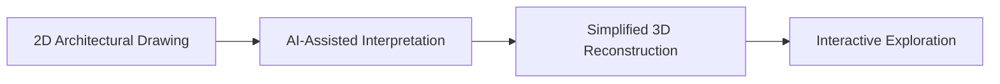

# 🔥 HEPHAESTUS

<p align="center">
  <strong>From drawing to space.</strong><br />
  An early-stage project exploring how AI-assisted 3D visualization could help learners understand architectural drawings.
</p>

<p align="center">
  <a href="https://hephaestus-studio.vercel.app/"></a>
  
</p>

---

## 🏛️ Overview

**Hephaestus** is an early-stage educational technology project exploring a simple idea: help people move from reading a 2D architectural drawing to understanding the 3D space it represents.

Architectural plans communicate a great deal through lines, boundaries, and dimensions. For learners who are still developing spatial visualization skills, imagining the resulting building from a flat drawing can be challenging.

Hephaestus aims to make that process more intuitive through an interactive web experience. The long-term vision is to use **AI-assisted drawing interpretation** to derive relevant geometry from supported architectural drawings and create a simplified 3D building model that users can inspect from different viewpoints.

The project is intended for **architecture students, civil engineering and construction-related students, and educators** who teach drawing interpretation and spatial visualization.

## 💡 The Idea

The proposed experience follows four stages:



1. **Provide a drawing** — upload a supported drawing, with phone-camera capture as a potential input route.
2. **Interpret the geometry** — identify relevant contours and spatial information from the drawing.
3. **Build a 3D representation** — create a simplified model focused on the building's overall form and major geometry.
4. **Explore the space** — rotate, zoom, and inspect the model to better understand its shape and spatial relationships.

> **Important:** This diagram describes the intended product workflow. The complete AI-assisted blueprint-to-3D pipeline is not implemented yet.

## 🎯 Why It Matters

Hephaestus aims to support learning by making abstract spatial relationships easier to explore.

- **Connect 2D and 3D:** help learners relate plan geometry to a building's overall form.
- **Learn through interaction:** allow users to inspect a model from different viewpoints rather than relying only on a static image.
- **Support teaching:** provide a potential visual aid for lessons involving architectural drawings and spatial reasoning.
- **Keep the workflow accessible:** build toward a responsive web experience for desktop and mobile devices.

Hephaestus is intended as an educational aid, not a replacement for professional CAD/BIM tools, architectural training, or qualified design review.

## 🚧 Current Status

The project is actively being developed. The current demo provides a pre-built 3D model so users can explore the intended interactive viewing experience.

The repository also contains an **experimental, rule-based DXF geometry workflow** for a limited set of drawing conditions. This is not the same as AI-powered interpretation and should be treated as an early prototype.

| Capability | Current status |
|---|---|
| Interactive viewing of a pre-built 3D model | Available in the demo |
| Explore model viewpoints and visual modes | Available in the prototype workspace |
| Preliminary geometry generation from supported DXF contours | Experimental; output and assumptions must be checked |
| PNG/JPG architectural drawing input | Preview only; images are not currently reconstructed into 3D |
| AI-assisted interpretation of drawings | Under development / planned |
| Automated reconstruction from ordinary blueprint photos | Not implemented yet |
| Educational evaluation with students and educators | Planned |

### Current DXF limitations

The experimental DXF workflow is designed for constrained vector drawings, not arbitrary architectural files. The current interface describes support for ASCII DXF files with closed, straight boundaries on selected layers such as `WALL`, `TUONG`, `COLUMN`, `COT`, `SLAB`, or `SAN`. Single-level plans are the current target, and drawing units and floor height may require user confirmation.

These constraints are subject to change as the prototype evolves. A generated model should be treated as a preliminary visualization, not as a validated architectural model.

## 🧭 Development Roadmap

- [x] Build an interactive 3D demonstration experience.
- [x] Establish the initial web interface and model-viewing workspace.
- [x] Add an experimental, constrained DXF geometry workflow.
- [ ] Improve drawing interpretation and handling of varied plan structures.
- [ ] Develop the AI-assisted pipeline for interpreting supported drawings.
- [ ] Evaluate reconstruction quality using representative drawings.
- [ ] Gather feedback from students and educators to assess usability and learning value.
- [ ] Explore mobile-camera workflows for connecting a drawing with its 3D visualization.

## 🧰 Technology Stack

### Frontend

- **JavaScript** — application logic
- **Vite** — development server and build tooling
- **Three.js** — interactive 3D rendering

### Backend

- **Python 3.14+**
- **FastAPI** — API framework
- **Uvicorn** — ASGI server

### Development and deployment tools

- **Bun** — frontend package management and scripts
- **uv** — Python dependency management
- **Docker** — containerized deployment configuration
- **Vercel** — hosted frontend demo
- **Render** — backend deployment configuration

The backend currently provides basic health and project-metadata endpoints. It does **not** currently provide the AI reconstruction pipeline.

## 🗂️ Project Structure

```text
Hephaestus/
├── backend/
│   ├── main.py              # FastAPI application and basic API endpoints
│   ├── pyproject.toml       # Python project and dependencies
│   └── uv.lock              # Locked Python dependencies
├── frontend/
│   ├── src/
│   │   ├── main.js          # Frontend entry point
│   │   ├── model.js         # Sample models and geometry helpers
│   │   ├── scene.js         # 3D scene and viewer
│   │   ├── workspace.js     # Drawing/model workspace interactions
│   │   └── drawing-worker.js # Drawing parsing worker
│   ├── package.json
│   └── bun.lock
├── Dockerfile
├── render.yaml
└── start.sh
```

## 🖥️ Run Locally

### Prerequisites

- [Bun](https://bun.sh/) for the frontend
- [Python 3.14 or newer](https://www.python.org/) for the backend
- [uv](https://docs.astral.sh/uv/) for Python dependencies

### 1. Clone the repository

```bash
git clone https://github.com/rcryan-hniht/Hephaestus.git
cd Hephaestus
```

### 2. Start the frontend

From the repository root:

```bash
cd frontend
bun install
bun run dev
```

Open the local URL printed by Vite in your terminal, usually `http://localhost:5173`.

### 3. Start the backend (separate terminal)

From the repository root in a second terminal:

```bash
cd backend
uv sync
uv run uvicorn main:app --reload --port 8000
```

The backend health endpoint should then be available at `http://localhost:8000/health`.

> The frontend and backend can be started independently. The current backend is minimal; starting it does not enable AI-based drawing reconstruction.

## 🔌 Current API Endpoints

| Method | Endpoint | Purpose |
|---|---|---|
| `GET` | `/health` | Basic service health check |
| `GET` | `/api/projects` | Returns current sample-project metadata |

These endpoints are an initial backend scaffold and do not process drawing uploads.

## 🔭 Long-Term Direction

The long-term direction is to investigate a reliable path from supported architectural drawings to useful 3D learning visualizations. Priorities include robust geometry interpretation, clear handling of uncertain dimensions and assumptions, and testing the results against representative drawings.

The project will need technical evaluation and feedback from its intended educational users before claims about reconstruction quality or learning outcomes can be made.

## ⚠️ Scope and Limitations

- This is an early-stage prototype and research direction.
- AI-assisted blueprint interpretation and photo-to-3D reconstruction are not yet complete.
- Raster images currently serve as previews; they are not automatically converted into 3D models.
- Experimental DXF output depends on drawing structure, supported contours, units, and user-confirmed assumptions.
- Models are intended for conceptual and educational visualization, not construction, engineering approval, or professional design verification.
- The project has not yet established measured learning improvements or professional-grade reconstruction accuracy.

## 🤝 Feedback

Feedback from architecture and engineering students, educators, and developers is valuable as the project develops. Suggestions and issue reports are welcome through the [GitHub Issues](https://github.com/rcryan-hniht/Hephaestus/issues) page.

## 📄 License

A license has not yet been specified in this repository. Please check the repository for licensing updates before reusing or redistributing the code.

---

<p align="center">
  <strong>Hephaestus — from drawing to space.</strong><br />
  <sub>Turning architectural drawings into an interactive path toward spatial understanding.</sub>
</p>
