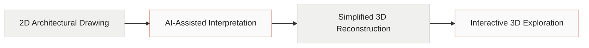

```markdown
# 🔥 HEPHAESTUS

<p align="center">
  <strong>From Drawing to Space.</strong>
  <br />
  Exploring how AI can bridge the gap between 2D architectural drawings and 3D spatial understanding.
</p>

<p align="center">
  <a href="https://hephaestus-studio.vercel.app/">
    
  </a>
  
</p>

---

## 📑 Table of Contents

- [Overview](#-overview)
- [The Problem](#-the-problem)
- [Our Solution](#-our-solution)
- [How It Works](#-how-it-works)
- [Key Features](#-key-features)
- [Current Development Status](#-current-development-status)
- [Technology Stack](#-technology-stack)
- [Project Structure](#-project-structure)
- [Getting Started](#-getting-started)
- [API Endpoints](#-api-endpoints)
- [Development Roadmap](#-development-roadmap)
- [Scope and Limitations](#-scope-and-limitations)
- [Contributing](#-contributing)
- [License](#-license)

---

## 🏛️ Overview

**Hephaestus** is an early-stage educational technology project exploring how AI-assisted architectural drawing interpretation can help learners visualize three-dimensional space.

Architectural drawings communicate building layouts through lines, boundaries, dimensions, and geometric relationships. However, understanding how these two-dimensional representations correspond to a three-dimensional building can be challenging for learners who are still developing spatial visualization skills.

Hephaestus aims to make this learning process more intuitive through an interactive web experience. Its long-term vision is to interpret supported architectural drawings and reconstruct simplified 3D building models that users can rotate, zoom, and explore.

The project focuses on educational visualization rather than professional-grade architectural design.

**Project vision:** Make architectural space easier to understand by connecting 2D drawings with interactive 3D representations.

## 🎯 The Problem

Learning to read architectural drawings requires more than recognizing lines and symbols. Learners must mentally translate a flat representation into an understanding of three-dimensional structures.

This can be challenging when studying:

- Building layouts and spatial relationships.
- Wall boundaries and major geometric structures.
- The overall form of a building from a 2D plan.
- The relationship between a drawing and its corresponding 3D representation.

Static drawings remain essential, but interactive visualization could provide another way for learners to explore the spaces represented by those drawings.

## 💡 Our Solution

Hephaestus aims to develop an **AI-assisted workflow that transforms supported architectural drawings into simplified, interactive 3D building models**.

The intended experience combines drawing interpretation, geometric reconstruction, and interactive 3D visualization in a web application accessible from desktop and mobile devices.

### Target Users

- **Architecture students** learning to interpret architectural plans.
- **Civil engineering and construction-related students** developing spatial visualization skills.
- **Educators** looking for interactive teaching aids for architectural drawing interpretation.

### Expected Educational Value

- Connect two-dimensional drawings with three-dimensional forms.
- Help learners explore building geometry from different viewpoints.
- Make spatial relationships easier to investigate visually.
- Complement traditional teaching methods with interactive visualization.

These are intended benefits that require further testing and educational validation.

## 🔄 How It Works

The following diagram illustrates the **proposed product workflow**, not a fully implemented AI pipeline.



### 1. Provide an Architectural Drawing

The intended workflow allows users to provide an existing drawing or, in a future iteration, capture a drawing with a phone camera.

### 2. Interpret the Drawing

The planned AI-assisted pipeline will aim to identify relevant geometric boundaries and spatial information from supported drawings.

### 3. Reconstruct a Simplified 3D Model

The system aims to convert interpreted geometry into a simplified building representation, prioritizing overall form and major structural geometry.

### 4. Explore the Model

Users will be able to inspect the resulting model through interactive 3D controls, such as rotation and zoom.

Future iterations may also explore a bottom-up assembly animation to make the transformation more engaging.

## 🧩 Key Features

The current prototype and the intended product include different levels of functionality.

| Feature | Description | Status |
|---|---|---|
| Interactive 3D viewer | Explore a pre-built 3D demonstration model | Available |
| 3D scene controls | Inspect the model from different viewpoints | Available in the prototype |
| Drawing preview | Load supported PNG/JPG images for visual preview | Available |
| DXF geometry workflow | Interpret a limited set of closed vector contours and extrude them into simple geometry | Experimental |
| AI-assisted drawing interpretation | Interpret supported drawings using AI | Under development |
| Automated blueprint-to-3D reconstruction | Generate a corresponding 3D model from a submitted drawing | Not yet implemented as a complete AI pipeline |
| Mobile-camera visualization | Explore a workflow connecting a physical drawing with its 3D representation | Future direction |

The current interactive demonstration uses a pre-built model to illustrate the intended model-viewing experience. The existence of this demonstration does not mean that automated AI reconstruction is complete.

## 🚧 Current Development Status

Hephaestus is actively being developed.

The team has established an interactive 3D demonstration experience. The repository also contains an experimental, rule-based DXF geometry workflow that can reconstruct simple geometry from certain supported vector boundaries.

This experimental workflow is **not an AI-powered blueprint understanding system**. It is limited by drawing structure and geometric assumptions.

The main technical objective is to progress from a constrained prototype toward a more reliable pipeline that can interpret supported architectural drawings and generate corresponding 3D geometry.

No formal evaluation of educational outcomes or reconstruction accuracy has been established yet.

## 🛠️ Technology Stack

### Frontend

- **JavaScript** — application logic.
- **Vite** — frontend development server and build tooling.
- **Three.js** — interactive 3D rendering and visualization.
- **Bun** — JavaScript package management and development scripts.

### Backend

- **Python 3.14+** — backend runtime.
- **FastAPI** — API framework.
- **Uvicorn** — ASGI server.
- **uv** — Python dependency management.

### Deployment

- **Vercel** — hosted frontend demo.
- **Render** — backend deployment configuration.

The backend currently provides basic health and project metadata endpoints. The complete AI-assisted reconstruction pipeline is not yet available through the backend.

## 📂 Project Structure

```text
Hephaestus/
├── backend/
│   ├── main.py               # FastAPI application
│   ├── pyproject.toml        # Python dependencies and project config
│   ├── requirements.txt      # Python dependency list
│   └── uv.lock               # Locked Python dependencies
│
├── frontend/
│   ├── src/
│   │   ├── main.js           # Frontend entry point
│   │   ├── model.js          # Sample models and geometry processing
│   │   ├── scene.js          # 3D scene and viewer
│   │   ├── workspace.js      # Drawing and model workspace
│   │   └── drawing-worker.js # Drawing parsing worker
│   ├── package.json
│   └── bun.lock
│
├── Dockerfile
├── render.yaml
└── start.sh
```

## 🚀 Getting Started

Follow these steps to run the frontend and backend locally.

### Prerequisites

Install the following tools:

- [Git](https://git-scm.com/)
- [Bun](https://bun.sh/)
- [Python 3.14 or newer](https://www.python.org/)
- [uv](https://docs.astral.sh/uv/)

### 1. Clone the Repository

```bash
git clone https://github.com/rcryan-hniht/Hephaestus.git
cd Hephaestus
```

### 2. Run the Frontend

Open a terminal at the repository root and execute:

```bash
cd frontend
bun install
bun run dev
```

Open the local URL displayed by Vite in your terminal. The default development address is usually:

`http://localhost:5173`

### 3. Run the Backend

Open a second terminal at the repository root:

```bash
cd backend
uv sync
uv run uvicorn main:app --reload --port 8000
```

The backend will be available at:

`http://localhost:8000`

Check the service health at:

`http://localhost:8000/health`

The frontend and backend are started separately during local development.

**Note:** Starting the backend does not enable AI-based drawing reconstruction. The current API is a basic foundation for future development.

## 🔌 API Endpoints

The current backend exposes the following endpoints:

| Method | Endpoint | Description |
|---|---|---|
| `GET` | `/health` | Returns the service health status |
| `GET` | `/api/projects` | Returns sample project metadata |

Example health response:

```json
{
  "status": "ok"
}
```

These endpoints provide basic service and project information. They do not currently perform AI inference or process drawing uploads.

## 🗺️ Development Roadmap

Hephaestus will be developed incrementally, prioritizing technical feasibility and educational usefulness.

- [x] Establish the initial web application.
- [x] Create an interactive 3D demonstration experience.
- [x] Implement an experimental, constrained DXF geometry workflow.
- [ ] Improve geometry interpretation and validation.
- [ ] Develop the AI-assisted architectural drawing interpretation pipeline.
- [ ] Generate simplified 3D models from supported drawings through the intended end-to-end workflow.
- [ ] Test reconstruction behavior on representative architectural drawings.
- [ ] Gather feedback from students and educators.
- [ ] Evaluate usability and potential educational value.
- [ ] Explore future mobile-camera visualization.

## ⚠️ Scope and Limitations

Hephaestus is an early-stage prototype and research direction. Several important limitations apply:

- The complete AI-assisted blueprint-to-3D pipeline is not implemented yet.
- PNG/JPG inputs are currently available for preview, not automatic 3D reconstruction.
- The experimental DXF workflow supports a restricted set of simple, closed vector boundaries.
- Doors, stairs, roofs, multiple-floor relationships, and other complex architectural details are not reliably reconstructed by the current experimental workflow.
- The current geometry workflow uses assumptions, including user-confirmed height and an assumed slab thickness.
- Generated geometry has not been validated for professional architectural accuracy.
- Educational benefits have not yet been confirmed through formal user studies.

Hephaestus is intended to support conceptual and educational visualization. It is **not a replacement for professional CAD/BIM software, architectural expertise, structural engineering analysis, or construction documentation**.

## 🤝 Contributing

Feedback and suggestions from students, educators, architects, engineers, and developers are welcome.

Potential areas for contribution include:

- Architectural drawing interpretation.
- Geometric reconstruction and validation.
- Interactive 3D visualization.
- Responsive interface design.
- Educational usability and evaluation.

Please use [GitHub Issues](https://github.com/rcryan-hniht/Hephaestus/issues) to report bugs, discuss ideas, or suggest improvements.

## 📄 License

A license has not yet been specified for this repository. Check the repository for licensing updates before reusing, modifying, or redistributing the code.

---

<p align="center">
  <strong>HEPHAESTUS</strong>
  <br />
  Turning architectural drawings into an interactive path toward spatial understanding.
</p>
```